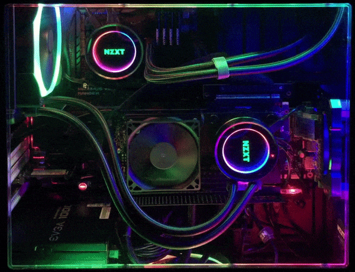
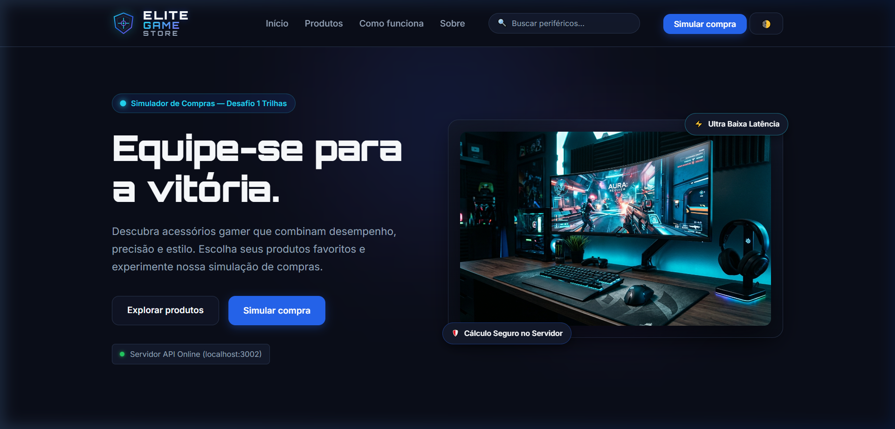
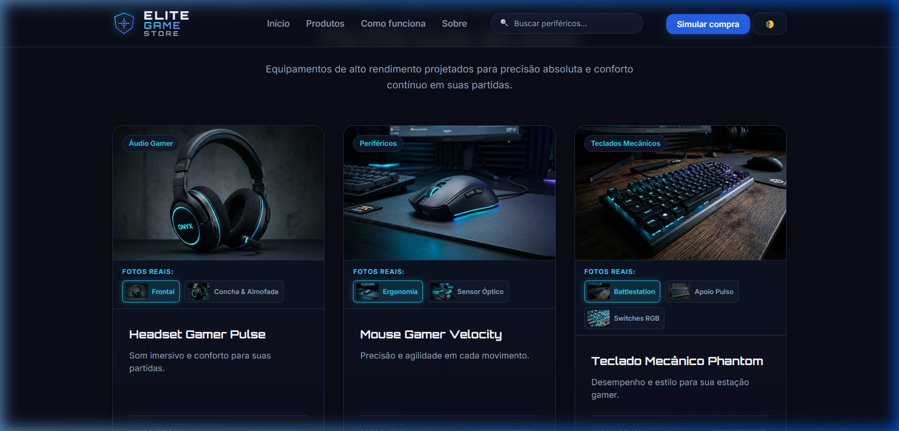
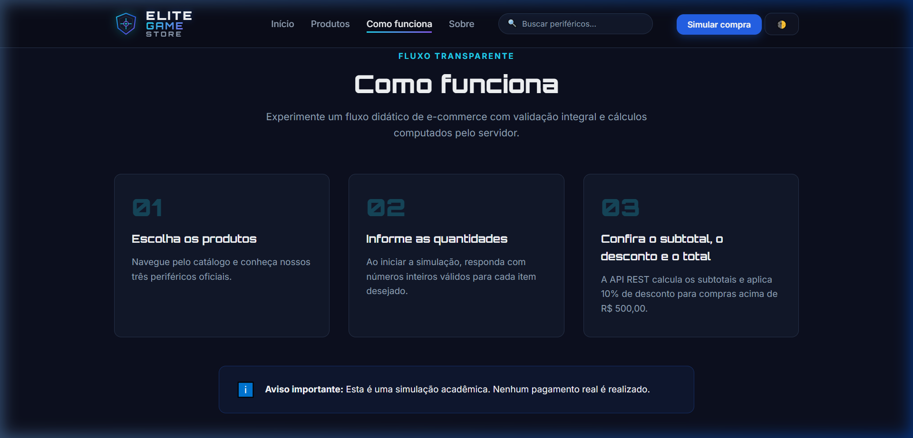
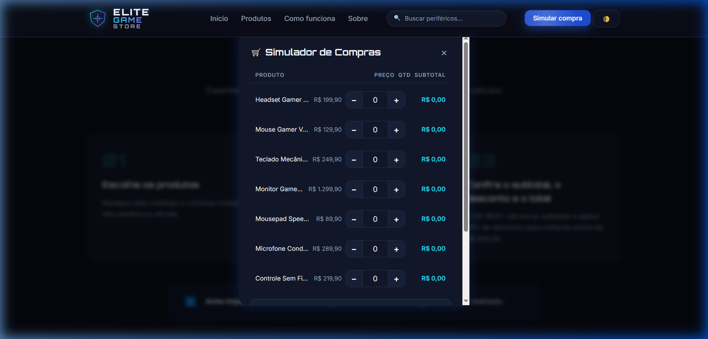
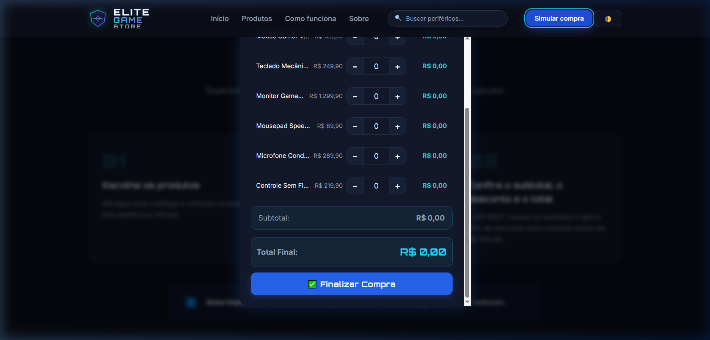
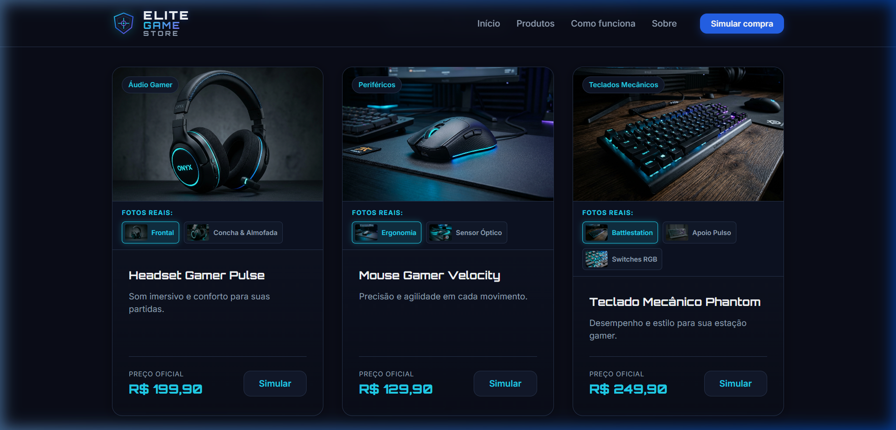

# 🎮 ELITE GAME STORE — Simulador de Compras Oficial

<div align="center">



<br>

[](https://github.com/)
[](https://developer.mozilla.org/pt-BR/docs/Web/HTML)
[](https://developer.mozilla.org/pt-BR/docs/Web/CSS)
[](https://developer.mozilla.org/pt-BR/docs/Web/JavaScript)
[](https://nodejs.org/)
[](https://expressjs.com/)

> *“Equipe-se para a vitória. Jogue em outro nível.”*

**Aplicação Web Full Stack de e-commerce gamer de alta fidelidade com interface interativa, simulação financeira em tempo real e arquitetura de back-end com cálculos seguros.**

</div>

---

## 📌 Identificação Acadêmica

- **Instituição / Programa:** Trilhas
- **Curso:** Técnico em Desenvolvimento de Sistemas
- **Trilha:** Lógica de Programação com JavaScript
- **Atividade:** Desafio 1 — Minha Loja: Simulador de Compras
- **Ano Acadêmico:** 2026
- **Autor / Aluno:** Luã Hayalla Oliveira Silva

---

## 📸 Demonstração Visual e Telas do App

> Todas as telas abaixo são capturas reais da aplicação em funcionamento, com back-end Node.js ativo e API conectada.

---

### 🎬 1. Hero Banner — Battlestation Animada em Loop

A primeira impressão da loja: um **GIF animado em loop** da estação gamer de alta performance com efeitos de zoom suave, brilho pulsante e bordas RGB cíclicas. O banner exibe também **selos flutuantes** com tecnologias-chave e um **badge de status da API** com indicador de conexão em tempo real.


> 🔵 **Detalhes técnicos do GIF:** 40 frames · 900×480px · 80ms/frame · loop infinito · efeitos: zoom breathing, RGB border, brilho pulsante, partículas flutuantes e texto com fade-in/out.

| Elemento Visual | Descrição |
| :--- | :--- |
| 🌀 Zoom Breathing | Efeito de zoom suave de 1.0× a 1.06× em loop contínuo |
| 🌈 Bordas RGB | Cor da borda muda ciclicamente em espectro completo |
| ✨ Partículas | 7 partículas flutuantes com opacidade e cor animadas |
| 📛 Texto Overlay | Título "ELITE GAME STORE" com fade-in/out dourado |
| ⚡ Badge Superior | Selo "Ultra Baixa Latência" flutuante no topo |
| 🛡️ Badge Inferior | Selo "Cálculo Seguro no Servidor" flutuante na base |

<br>

---

### 🖥️ 2. Interface Principal — Hero Section & Navbar

Tela inicial da aplicação mostrando o layout completo: **navbar fixa com busca integrada**, headline principal, botões de ação e o badge de status da API backend.



| Componente | Funcionalidade |
| :--- | :--- |
| 🔝 Navbar Fixa | Sempre visível com logo, links de navegação, barra de pesquisa e botões de ação |
| 🔍 Barra de Pesquisa | Input integrado no navbar com filtro em tempo real dos produtos |
| 🌓 Botão Tema | Alterna entre Modo Noturno e Modo Claro com ícone dinâmico |
| 🛒 Botão "Simular compra" | Abre o simulador com lista completa de produtos da loja |
| 📡 Badge API Status | Indicador verde/amarelo/vermelho de conexão com o back-end |
| 🎯 CTA "Explorar produtos" | Rolagem suave até a seção de catálogo |

<br>

---

### 🛍️ 3. Catálogo de Produtos com Cards Interativos

Grade responsiva com **7 periféricos gamer** organizados em cards premium. Cada card exibe imagem em alta resolução, nome, descrição técnica, preço formatado em Real brasileiro e botões de ação individuais.



| Elemento do Card | Descrição |
| :--- | :--- |
| 🖼️ Imagem do Produto | Foto real do periférico em alta qualidade com fallback automático |
| 📋 Nome & Descrição | Título em tipografia Orbitron + descrição técnica completa |
| 💰 Preço Oficial | Valor formatado em R$ via `Intl.NumberFormat('pt-BR')` |
| 🔘 Botão "Simular" | Abre o modal focado neste produto específico com seletor de quantidade |
| 🏷️ Badge de Categoria | Chip visual indicando a categoria (Áudio, Periféricos, Monitores, etc.) |

<br>

---

### ⚙️ 4. Seção do Simulador de Compras

Seção dedicada ao simulador com explicação visual do fluxo de compra, destacando a arquitetura **Full Stack** (front-end → API REST → back-end Node.js):



| Passo | Descrição |
| :--- | :--- |
| **1️⃣ Selecione** | Escolha o produto no catálogo ou abra o simulador completo |
| **2️⃣ Quantity** | Ajuste a quantidade com os botões `−` e `+` no modal |
| **3️⃣ Calcule** | O subtotal é calculado em tempo real; desconto de 10% acima de R$ 500 |
| **4️⃣ Finalize** | Clique em "Finalizar Compra" para receber o extrato completo via `alert()` |

<br>

---

### 🧾 5. Modal Interativo — Simulador de Compras

Janela modal estilizada que abre ao clicar em qualquer botão "Simular compra". Exibe **lista completa de produtos**, controles de quantidade individuais, subtotais em tempo real e desconto automático:



> 💡 O modal pode ser aberto de **4 pontos diferentes** da página: header, hero, seção simulador e cards individuais de produtos.

| Funcionalidade do Modal | Detalhe |
| :--- | :--- |
| 📦 Lista de Produtos | Todos os itens do catálogo ou o produto específico do card clicado |
| ➕➖ Controle de Quantidade | Botões `−` e `+` com validação (mínimo 0, máximo 99) |
| 💵 Subtotal em Tempo Real | Multiplicação `quantidade × preço` atualizada instantaneamente |
| 🏷️ Desconto Automático | 10% aplicado e destacado em verde quando subtotal ≥ R$ 500,00 |
| ✅ Finalizar Compra | Envia requisição `POST /api/compras/simular` ao back-end com os dados |
| ❌ Fechar Modal | Botão `×` ou tecla `Escape` fecha o modal com animação suave |

<br>

---

### 🖼️ 6. Galeria da Comunidade & Estúdio — Fotos em Alta Resolução

Seção de estúdio com **equipamentos fotografados em ambientes reais** de alta performance. Cada periférico possui ficha técnica completa com chips de especificação:



| Elemento da Galeria | Detalhe |
| :--- | :--- |
| 📷 Fotos de Estúdio | Imagens reais em alta resolução (headset, mouse, teclado, monitor) |
| 🏷️ Chips de Spec | Especificações técnicas como "26K DPI", "240Hz 1ms", "32h Bateria" |
| 📝 Ficha Técnica | Descrição de engenharia completa para cada periférico |
| 🖱️ Hover Interativo | Efeito de zoom e overlay ao passar o mouse sobre cada foto |

<br>

---

### 🌓 7. Modo Noturno & Modo Claro (Dark/Light Theme)

Alternância instantânea de tema com transição suave de 0.3s em toda a paleta de cores, gradientes e superfícies. A preferência é salva no `localStorage`:



| Aspecto | Modo Claro ☀️ | Modo Noturno 🌙 |
| :--- | :--- | :--- |
| **Fundo** | `#f8fafc` — cinza claro | `#0a0a1a` — azul-escuro profundo |
| **Cards** | Branco com sombra suave | Glassmorphism com backdrop-blur |
| **Textos** | `#1e1e2e` escuro | `#e2e8f0` claro |
| **Gradientes** | Tons pastel gamer | Púrpura e azul neon profundos |
| **Persistência** | `localStorage.setItem('theme', 'light')` | `localStorage.setItem('theme', 'dark')` |

---

## ✨ Funcionalidades do Aplicativo

### 🛒 1. Simulador de Compras Interativo

- **Acesso Unificado:** Disponível a partir de múltiplos pontos da loja — botão do cabeçalho, botão do banner principal (Hero), botão da seção de simulação e botões individuais em cada card de produto.
- **Simulação Individual e Geral:**
  - Clicando no card de um produto específico, a janela abre focada naquele item com seletor de quantidade e subtotal imediato.
  - Clicando nos botões principais da página, a janela lista todos os itens da loja para montar o carrinho completo.
- **Cálculo de Subtotais e Desconto:** Multiplicação de quantidade × preço em tempo real. Se o subtotal atingir **R$ 500,00 ou mais**, a loja aplica automaticamente **10% de desconto** com destaque visual em verde.
- **Extrato Financeiro Oficial:** Demonstração completa de cada item comprado, descontos e total final exibidos com formatação brasileira via `Intl.NumberFormat` em `alert()` e no painel do DOM.
- **Modo Clássico Acadêmico:** Suporte integral às funções fundamentais solicitadas na grade do Trilhas (`prompt()`, `Number()`, `alert()`, `fetch()`).

### 🔍 2. Barra de Pesquisa em Tempo Real no Navbar

- Localizada diretamente na barra de navegação superior para acesso rápido.
- **Filtro Instantâneo:** Filtra os produtos do catálogo conforme o usuário digita (por nome, descrição ou categoria).
- **Rolagem Automática:** Rola a tela suavemente até a seção de catálogo caso o usuário comece a pesquisar enquanto estiver em outra parte da página.
- **Botão Limpar (`✕`):** Botão dinâmico que surge ao digitar, permitindo redefinir a busca com apenas um clique.
- **Mensagem Amigável:** Exibe feedback visual elegante caso nenhum periférico corresponda ao termo buscado.

### 🌓 3. Modo Noturno e Modo Claro (Dark/Light Mode)

- Alternância instantânea com transição suave de cores e gradientes.
- Ícone dinâmico no botão (`🌓` para modo noturno e `☀️` para modo claro).
- **Persistência em `localStorage`:** A preferência de tema do usuário é salva no navegador e mantida ao recarregar a página.

### 🖼️ 4. Galeria de Fotos Reais e Ficha Técnica

- Equipamentos fotografados em alta resolução em estúdio e em competições de eSports.
- Cada item conta com título, descrição completa de engenharia e **chips de especificações técnicas** (ex.: *Curvo 240Hz 1ms*, *Sensor PixArt 26K DPI*, *Bateria até 32h*).
- Miniaturas interativas nos cards de produtos que alternam a foto ativa com visualização em diferentes ângulos ao clicar ou passar o mouse.

### 📡 5. Indicador de Conexão com API em Tempo Real

- Badge dinâmico no topo da página que monitora a saúde do servidor Express:
  - 🟢 **Online:** Servidor conectado e pronto para processar requisições.
  - 🟡 **Conectando:** Verificando comunicação inicial.
  - 🔴 **Offline:** Alerta amigável orientando o usuário a iniciar o back-end.

---

## 🕹️ Catálogo Oficial de Produtos

| ID | Produto | Categoria | Destaques Técnicos | Preço Oficial | Centavos (Back-end) |
| :--- | :--- | :--- | :--- | :--- | :--- |
| `headset-pulse` | **Headset Gamer Pulse** | Áudio Gamer | Drivers 50mm, Espuma Viscoelástica | **R$ 199,90** | `19990` |
| `mouse-velocity` | **Mouse Gamer Velocity** | Periféricos | 26K DPI, Polling 1000Hz, 62g | **R$ 129,90** | `12990` |
| `teclado-phantom` | **Teclado Mecânico Phantom** | Teclados | Switches Táteis, Keycaps PBT, RGB | **R$ 249,90** | `24990` |
| `monitor-horizon` | **Monitor Gamer Horizon 240Hz** | Monitores | Painel Curvo 1ms, 240Hz, HDR | **R$ 1.299,90** | `129990` |
| `mousepad-goliath` | **Mousepad Speed Goliath XXL** | Acessórios | Tecido Micro-texturizado, LED RGB | **R$ 89,90** | `8990` |
| `microfone-streamer` | **Microfone Streamer Pro** | Áudio Gamer | Cápsula Cardioide, Shock Mount, Pop | **R$ 289,90** | `28990` |
| `controle-elite` | **Controle Trigger Elite** | Controles | Gatilhos Magnéticos Hall Effect | **R$ 219,90** | `21990` |

---

## 🏷️ Regras de Negócio e Segurança de Cálculos

1. **Fonte Única da Verdade no Servidor:** O front-end envia apenas o identificador do produto (`produtoId`) e a `quantidade`. O back-end **nunca confia em preços ou subtotais enviados pelo cliente**.
2. **Cálculos em Centavos Inteiros:** Todas as operações aritméticas no back-end operam com números inteiros (`19990`, `12990`) para evitar anomalias de arredondamento de ponto flutuante (*IEEE 754*).
3. **Política de Desconto da Loja:**
   - **Subtotal ≥ R$ 500,00:** 10% de desconto automático calculado sobre o subtotal.
   - **Subtotal < R$ 500,00:** Sem desconto (0%).
   - **Nenhum produto selecionado (todas quantidades = 0):** Resumo nulo sem cobrança.

---

## 🛠️ Tecnologias Utilizadas

### Front-end

- **HTML5 Semântico:** Marcação acessível estruturada com tags semânticas e atributos WAI-ARIA (`role="search"`, `aria-label`, `aria-expanded`).
- **CSS3 Puro (Vanilla CSS):** Design System customizado com variáveis CSS (`tokens`), CSS Grid, Flexbox, efeitos de *glassmorphism* e animações fluidas.
- **JavaScript Puro (ES6+):** Manipulação reativa do DOM, requisições assíncronas com `fetch()`, manipulação de eventos e `Intl.NumberFormat`.
- **LocalStorage:** Armazenamento seguro de preferências de tema.

### Back-end

- **Node.js (v20+):** Ambiente de execução assíncrono e orientado a eventos.
- **Express.js:** Framework minimalista para criação de rotas e APIs RESTful.
- **CORS:** Middleware para habilitação segura de requisições locais cross-origin.
- **Testes Nativos:** Módulo `node:assert/strict` para validação matemática automatizada.

---

## 📁 Estrutura de Diretórios

```text
FULL STACK ELITE GAME STORE/
├── frontend/
│   ├── index.html           # Página principal com header, hero, catálogo e modal
│   ├── style.css            # Folha de estilos com design tokens e modo claro/escuro
│   ├── script.js            # Lógica interativa, simulador, busca e integração com API
│   └── assets/              # Mídias locais, GIF animado e ícones SVG oficiais
│       ├── setup-gamer-hero.gif
│       ├── setup-gamer-hero.jpg
│       ├── logo-icon.svg
│       └── ...
├── backend/
│   ├── src/
│   │   ├── server.js        # Inicialização do servidor Express (Porta 3002)
│   │   ├── routes/
│   │   │   ├── produtos.js  # Rota GET /api/produtos
│   │   │   └── compras.js   # Rota POST /api/compras/simular
│   │   ├── services/
│   │   │   └── simulacaoService.js # Regras de cálculo, centavos e desconto
│   │   └── data/
│   │       └── produtos.js  # Catálogo oficial da loja (fonte da verdade)
│   ├── test/
│   │   └── simulacao.test.js # Bateria de testes automatizados de regras financeiras
│   ├── package.json         # Dependências e scripts do servidor
│   └── .env.example         # Exemplo de configuração de porta
├── screenshots/             # Imagens e GIF de demonstração do README
│   ├── setup-gamer-hero.gif
│   ├── hero_banner_preview.png
│   ├── modal_simulador_preview.png
│   └── catalogo_oficial_fotos_reais.png
├── README.md                # Documentação técnica e didática oficial
└── .gitignore               # Arquivos ignorados pelo Git
```

---

## ⚙️ Como Executar o Projeto Localmente

### Pré-requisitos

- **Node.js** (versão 18 ou superior instalada). Verifique com `node -v`.

---

### Passo 1: Iniciar o Back-end (API Node.js/Express)

1. Abra um terminal na pasta do projeto e acesse o diretório do back-end:

   ```bash
   cd "backend"
   ```

2. Instale as dependências (se for a primeira execução):

   ```bash
   npm install
   ```

3. *(Opcional)* Execute a bateria de testes automatizados para validar as regras financeiras:

   ```bash
   npm test
   ```

4. Inicie o servidor:

   ```bash
   npm start
   ```

   *O servidor estará disponível em: `http://localhost:3002`.*

---

### Passo 2: Executar o Front-end

Abra o arquivo `frontend/index.html` em qualquer navegador moderno (Google Chrome, Microsoft Edge, Mozilla Firefox) ou execute um servidor web local na pasta:

```bash
# Na raiz do projeto:
npx serve frontend -p 3000
```

Acesse no seu navegador: **`http://localhost:3000`** ou abra diretamente o arquivo `frontend/index.html`.

---

## 📡 Rotas da API REST

### `GET /api/health`

Retorna o status de integridade do servidor.

- **Resposta:** `{ "status": "ok", "uptime": 120.45, "timestamp": "..." }`

### `GET /api/produtos`

Retorna a lista completa com os produtos e preços oficiais cadastrados no back-end.

### `POST /api/compras/simular`

Processa a simulação com cálculo seguro de subtotais, desconto e valor final.

- **Payload de Exemplo:**

  ```json
  {
    "itens": [
      { "produtoId": "headset-pulse", "quantidade": 2 },
      { "produtoId": "teclado-phantom", "quantidade": 1 }
    ]
  }
  ```

- **Resposta com Desconto (Subtotal ≥ R$ 500):**

  ```json
  {
    "sucesso": true,
    "resumo": {
      "quantidadeTotalItens": 3,
      "subtotal": 649.70,
      "desconto": 64.97,
      "percentualDesconto": 10,
      "totalFinal": 584.73
    }
  }
  ```

---

## 🧪 Controle de Qualidade e Casos de Teste

| ID | Cenário | Entrada Testada | Resultado Esperado | Status |
| :---: | :--- | :--- | :--- | :---: |
| **01** | **Sem seleção** | Quantidade = 0 para todos os itens | Subtotal R$ 0,00, sem cobrança e aviso amigável | ✅ Aprovado |
| **02** | **Compra sem desconto** | 1x Mouse (R$ 129,90) | Subtotal R$ 129,90, desconto R$ 0,00, total R$ 129,90 | ✅ Aprovado |
| **03** | **Compra com desconto** | 1x Headset + 2x Teclado (R$ 699,70) | Desconto de 10% (R$ 69,97) e total R$ 629,73 | ✅ Aprovado |
| **04** | **Pesquisa de produtos** | Termos como "mouse", "teclado", "240hz" | Filtragem dinâmica imediata com contagem precisa | ✅ Aprovado |
| **05** | **Pesquisa sem resultado** | Termo inexistente (ex.: "xyz") | Card visual estilizado com botão para limpar busca | ✅ Aprovado |
| **06** | **Modo Claro / Escuro** | Clique no botão `🌓`/`☀️` | Alternância fluida de cores e persistência no localStorage | ✅ Aprovado |
| **07** | **Segurança de preços** | Envio de preço adulterado pelo cliente | Servidor descarta e calcula com base na fonte oficial | ✅ Aprovado |
| **08** | **Tratamento de Servidor Offline** | Back-end desligado | Indicador vermelho e alerta instruindo o usuário | ✅ Aprovado |

---

## 📝 Reflexões de Aprendizado do Aluno

> **Reflexões de Engenharia — Luã Hayalla:**
>
> 1. **Separação de Camadas (Full Stack):** Compreensão prática de como front-end e back-end cooperam, mantendo a interface leve e responsiva enquanto o servidor garante a integridade dos dados e regras financeiras.
> 2. **Validação Robusta:** Implementação de validação rigorosa tanto na entrada do usuário (com `prompt()`, `Number()` e expressões regulares) quanto na recepção dos payloads no Express.
> 3. **Design System & Acessibilidade:** Criação de uma identidade visual gamer imersiva com suporte a temas (claro/escuro) e responsividade mobile-first sem depender de bibliotecas externas pesadas.
> 4. **Tratamento de Precisão Monetária:** Adoção de centavos inteiros nas operações do back-end para prevenir discrepâncias inerentes à aritmética de ponto flutuante.

---

## 📄 Licença e Direitos

Projeto desenvolvido Mobile para fins educacionais e didáticos dentro do programa **Trilhas (2026)**.  
Distribuído sob a licença acadêmica livre para avaliação e aprendizado.

<div align="center">
  <sub>Desenvolvido  com ☕ e dedicação por <strong>Luã Hayalla Oliveira Silva</strong>.</sub>
</div>
